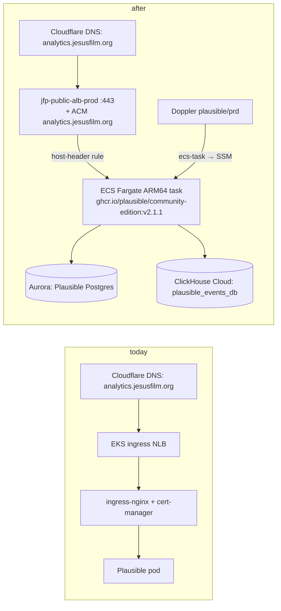

# feat: Run Plausible on ECS Fargate (Graviton) instead of the EKS Platform Cluster

## Summary

Plausible Analytics is the only product-facing workload on the EKS Platform Cluster; everything else there (ingress-nginx, cert-manager, external-dns, the Doppler operator, the EBS CSI driver, snapshot tooling) exists to serve it. Once its ClickHouse has moved to the shared ClickHouse Cloud service (plan `2026-10-14-001`), Plausible itself is a stateless Elixir container with two external databases, which is exactly what the ECS Fargate substrate already runs for every other Service. This plan runs the upstream `ghcr.io/plausible/community-edition` image as an ECS Service on arm64 Fargate (Graviton), behind the public ALB, with its configuration pulled from the existing `plausible` Doppler project, cuts the two hostnames over, and removes Plausible from EKS. Decommissioning the EKS cluster itself is the follow-up this makes possible.

---

## Problem Frame

Plausible runs on EKS via a wrapper Helm chart and Argo CD, with its own ingress controller, certificate issuer and DNS controller. That is a second runtime, a second GitOps path, a second way to do TLS and DNS, and a cluster to keep upgraded, for one single-replica Deployment. The product Services all run on ECS Fargate through one Terraform module (`modules/aws/ecs-task`) with Doppler-fed configuration, Datadog sidecars and ALB host-header routing. Moving Plausible onto that substrate removes the odd one out. Graviton halves the compute price relative to x86 Fargate for the same vCPU/memory, and the image and both sidecars are published for arm64.

---

## Assumptions

*Authored without synchronous confirmation; review before implementation.*

- **The ClickHouse migration lands first, per environment.** An ECS task cannot reach the in-cluster ClickHouse Service, so Plausible on ECS requires `CLICKHOUSE_DATABASE_URL` to already point at ClickHouse Cloud. The module work here can merge any time; the cutover units are gated on plan `001`'s U5 for the same environment.
- **Hostnames do not change.** `analytics.jesusfilm.org` (prod) and `analytics.stage.central.jesusfilm.org` (stage) keep serving Plausible; `BASE_URL` and `api-journeys`' `PLAUSIBLE_URL` are untouched.
- **The upstream image is used as published, pinned by tag.** No Dockerfile, no ECR mirror, no rebuild. The `ecs-task` module gains an `image` override for this; its ECR repository is still created and simply stays empty.
- **Plausible stays single-node.** CE keeps sessions and the ingest buffer in process memory, so the Service runs exactly one task and deploys with `minimum_healthy_percent = 0` / `maximum_percent = 100`: a few seconds of downtime per deploy rather than two writers at once (and two concurrent `db migrate` runs on upgrades).
- **No Plausible version bump here.** v2.1.1, as today. The CE v3 upgrade becomes a one-line change to the pinned tag once this lands.
- **Graviton means Fargate ARM64**, not an EC2 capacity provider. The cluster is Fargate-only and nothing in the repo uses `runtime_platform` yet.

---

## Requirements

- R1. Plausible runs as an ECS Fargate Service on ARM64 in each environment, from the pinned upstream image, with migrations run at container start and `/api/health` as the ALB health check.
- R2. Configuration comes from the existing `plausible` Doppler project (`stg` / `prd`) through the `ecs-task` module's SSM path, with no secret duplicated by hand.
- R3. Both hostnames keep working over HTTPS after cutover; stage's certificate is the existing wildcard, prod gets an ACM certificate for `analytics.jesusfilm.org` attached to the public listener.
- R4. Cutover per environment is a DNS change with a documented, rehearsed rollback (DNS back to the EKS ingress) while the EKS Deployment still exists.
- R5. Existing ECS Services see no Terraform diff from the `ecs-task` module changes.
- R6. After the rollback window, Plausible is removed from EKS: Argo CD applications, the wrapper chart, the Doppler operator secret, the api-analytics deploy copies; the runbooks move with it.
- R7. The infrastructure glossary and the Plausible runbook describe the new shape.

---

## Scope Boundaries

- The ClickHouse migration (plan `001`) is a dependency, not part of this plan.
- Decommissioning the EKS cluster, ingress-nginx, cert-manager, external-dns and the rest of `infrastructure/kube/` is a separate plan once Plausible is gone.
- No Plausible version change, no SMTP/MaxMind/Google integrations enabled, no change to `api-analytics` or `api-journeys`.
- No move of `analytics.jesusfilm.org` behind the Cloudflare proxy; it stays DNS-only as today.
- No EC2 / capacity-provider work; Graviton is Fargate ARM64 only.

### Deferred to Follow-Up Work

- **EKS Platform Cluster teardown**: its own plan after U7 here; every remaining app in `infrastructure/kube/argocd/applications/` is support tooling for Plausible.
- CE v3 upgrade (pinned tag bump plus ClickHouse-side checks from plan `001`).
- Retiring the `ebs-snapshot-policy` module directory and the CSI snapshot backlog (from plan `001` / #9618).

---

## Context & Research

### Relevant Code and Patterns

- `infrastructure/modules/aws/ecs-task/main.tf`: Fargate task + service + target group + host-header listener rule + Route53 CNAME `<name>.<zone>` + autoscaling. Image is hard-wired to the module's own ECR repo at `:latest`; no `command`, no `runtime_platform`, no deployment percentages exposed. Secrets are copied from Doppler (`data.doppler_secrets.app`, project `service_config.doppler_project_name` or the service name) into SSM `/ecs/<project>/<env>/<KEY>` and injected as container secrets. Datadog agent (`public.ecr.aws/datadog/agent:latest`) and FireLens (`amazon/aws-for-fluent-bit:stable`) sidecars, both multi-arch.
- `apps/arclight/infrastructure/{main,locals,variables}.tf` and the removed `apps/cms/infrastructure` (commit `33ff490f8`): the per-Service wrapper pattern (`service_config`, `environment_variables`, `host_name(s)`), including a third-party-image service (Strapi) that was given `host_name = "cms.jesusfilm.org"`.
- `infrastructure/environments/{stage,prod}/main.tf` + `data.tf`: `local.public_ecs_config` (public subnets, public ECS SG, public ALB, zone = `central.jesusfilm.org` on prod, `stage.central.jesusfilm.org` on stage), per-Service Doppler tokens read from SSM `/terraform/prd/DOPPLER_<SERVICE>_<ENV>_TOKEN`.
- `infrastructure/modules/aws/main.tf`: the public HTTPS listener's default certificate is `*.central.jesusfilm.org` (stage: `*.stage.central.jesusfilm.org`); extra hostnames (`arclight.org`, `arc.gt`, `*.nextstep.is`) are attached with `aws_lb_listener_certificate` from pre-existing ACM certs. `modules/aws/acm` creates a cert with Route53 DNS validation; usable only for zones Route53 serves.
- RDS security group `jfp-internal-rds-sg-<env>` allows 5432 from the whole VPC CIDR, so an ECS task reaches Plausible's Postgres with no new rule.
- DNS today (verified): prod `analytics.jesusfilm.org` is a DNS-only CNAME in **Cloudflare** (jesusfilm.org's nameservers are Cloudflare's; the Route53 `jesusfilm.org` zone does not hold the record) pointing at the prod EKS ingress NLB. Stage `analytics.stage.central.jesusfilm.org` is a CNAME in the Route53 `stage.central.jesusfilm.org` zone to the stage ingress NLB, created and owned by external-dns (`policy: upsert-only`, TXT registry).
- `infrastructure/kube/plausible-analytics/`: the chart being retired; `values*.yaml` `ingress` block is what external-dns and cert-manager act on. `infrastructure/kube/doppler/values*.yaml` + `templates/doppler-secrets.yaml`: the `DopplerSecret` for project `plausible` that feeds the pod.
- Doppler project `plausible` holds exactly: `BASE_URL`, `CLICKHOUSE_DATABASE_URL`, `DATABASE_URL`, `DISABLE_REGISTRATION`, `SECRET_KEY_BASE`, `TOTP_VAULT_KEY` (plus Doppler's own `DOPPLER_*`).
- Plausible CE v2.1.1: health route `GET /api/health`; listens on 8000; the image's entrypoint takes `db createdb`, `db migrate`, `run` (the wrapper chart's init container and `docker-compose.services.yml` both chain them). Image manifests for `v2.1.1` and `v3.2.1` list `linux/amd64` and `linux/arm64`.

### Institutional Learnings

- Plan `001` and memory `plausible-snapshot-retention-followups`: the api-analytics deploy scripts are a second, undeclared deploy path for the chart and must not run during either migration.

### External References

- ECS Fargate ARM64 (`runtime_platform { cpu_architecture = "ARM64" }`): https://docs.aws.amazon.com/AmazonECS/latest/developerguide/fargate-task-defs.html
- Plausible CE configuration: https://github.com/plausible/community-edition/wiki/Configuration

---

## Key Technical Decisions

- **Extend `ecs-task` additively rather than fork it.** Four optional inputs: `image` (default: the ECR repo at `:latest`), `command` (default: none, image CMD), `cpu_architecture` (default `X86_64`; the `runtime_platform` block is only rendered for `ARM64`, so existing task definitions do not change), `deployment_minimum_healthy_percent` / `deployment_maximum_percent` (default null, provider defaults). R5 is checked by the Atlantis plan of that PR showing no changes.
- **A `modules/plausible` wrapper, not an `apps/plausible/infrastructure`.** There is no Nx project and no code; the wrapper is the Service definition only, like `modules/clickhouse/service`. It pins the image tag in one variable (`plausible_version`, default `v2.1.1`) so the CE v3 upgrade is a one-line PR.
- **Service name `plausible`, hostnames explicit.** The module auto-creates `plausible.<zone>` (`plausible.central.jesusfilm.org`, `plausible.stage.central.jesusfilm.org`), covered by the wildcard certificates, which gives a smoke-test URL before any DNS moves. `host_names` carries both that and the real `analytics` hostname, so the listener rule is complete before cutover.
- **Prod certificate is requested by Terraform, validated by hand in Cloudflare, attached by Terraform.** The ACM validation CNAME has to live where `jesusfilm.org` is served (Cloudflare), so `modules/aws/acm`'s Route53 validation does not apply. The certificate resource lands first (no `aws_acm_certificate_validation`, which would block an Atlantis apply for up to 75 minutes); once ACM shows ISSUED, a second PR attaches it to the listener.
- **Stage DNS cutover removes the ingress first, then Terraform takes the record.** external-dns is `upsert-only` and owns `analytics.stage.central.jesusfilm.org` through its TXT registry; it would rewrite any out-of-band change to a record it still desires. Disabling the chart's `ingress` makes it stop desiring the record (it will not delete it under upsert-only), then an `aws_route53_record` with `allow_overwrite` points it at the public ALB. The orphaned `external-dns-analytics...` TXT records are deleted by hand.
- **Prod DNS cutover is a Cloudflare record edit**, documented in the runbook, exactly as the short-links routes are: CNAME `analytics` from the ingress NLB name to `jfp-public-alb-prod-...elb.amazonaws.com`, TTL already 300. Rollback is the same edit reversed. Terraform owns nothing in Cloudflare for jesusfilm.org and this plan does not start.
- **Single task, serialized deploys.** `desired_count = 1`, autoscaling min = max = 1, deploy 0%/100%. Plausible CE is not multi-node safe; a short gap per deploy is the honest trade.
- **Doppler token like every other Service.** A Doppler service token per config for project `plausible`, stored at `/terraform/prd/DOPPLER_PLAUSIBLE_STAGE_TOKEN` and `/terraform/prd/DOPPLER_PLAUSIBLE_PROD_TOKEN` (the naming the stacks already use), created by hand before the service PR is applied. The module then copies the six keys into SSM under `/ecs/plausible/<env>/`.
- **Task size 1 vCPU / 2 GiB, like the other services**, revisited from Datadog after a week; the EKS pod ran without requests/limits so there is no number to carry over.

---

## Open Questions

### Resolved During Planning

- Can Fargate pull `ghcr.io` anonymously? Yes for public images; the task runs in public subnets with a public IP (`is_public`), so egress exists.
- Does the image run on arm64? The `v2.1.1` manifest list includes `linux/arm64`; so do the Datadog agent and fluent-bit images.
- Does the Phoenix app mind being served under two hostnames? `BASE_URL` is used for generated links and cookies; health and ingestion work on any host. Dashboard login via the `plausible.<zone>` host may hit Phoenix origin checks, so smoke tests on that host are health + a test pageview, with the dashboard checked after DNS cutover.
- Who owns `analytics.jesusfilm.org`? Cloudflare DNS, unproxied, by hand. Who owns the stage record? external-dns, in Route53.

### Deferred to Implementation

- Exact `health_check_grace_period_seconds`: migrations run at start; begin at 120 s and adjust from the first stage deploy.
- Whether `NODE_ENV=production` and the other Node-flavoured defaults the module injects need excluding for an Elixir image (they are inert; left as is unless something complains).
- Whether the Datadog sidecar's APM settings produce noise for an app that does not emit traces; tune after the soak.
- Which `dd_source` gives the best log parsing (`plausible` vs `elixir`).

---

## High-Level Technical Design

> *Directional guidance for review, not implementation specification.*

---

## Implementation Units

- U1. **`ecs-task` module: image, command, CPU architecture, deployment percentages**

**Goal:** Let the shared module run a third-party image on ARM64 with a start command and serialized deploys, with zero diff for existing Services.

**Requirements:** R1, R5

**Dependencies:** None

**Files:**
- Modify: `infrastructure/modules/aws/ecs-task/variables.tf`, `infrastructure/modules/aws/ecs-task/main.tf`

**Approach:**
- `image` (string, null → current ECR `:latest` expression), `command` (list(string), null → omitted from the container definition via `merge`), `cpu_architecture` (`X86_64` | `ARM64`, dynamic `runtime_platform` only for ARM64), `deployment_minimum_healthy_percent` / `deployment_maximum_percent` (number, null → provider default).
- Validation blocks on `cpu_architecture` and the percentages.

**Patterns to follow:** existing `optional()` usage in `service_config`; `include_aws_env_vars` conditional concat.

**Test scenarios:**
- Happy path: Atlantis plan for the PR shows **no changes** for any existing Service's task definition or service (R5).
- Edge case: `tofu validate` with `command = null` renders a container definition without a `command` key (not `"command": null`).
- Error path: `cpu_architecture = "arm64"` (lowercase) is rejected by validation.

**Verification:** plan is empty; module validates.

---

- U2. **`modules/plausible`: the Service definition**

**Goal:** One wrapper that turns the upstream image into an ECS Service on ARM64 with Plausible's config and health check.

**Requirements:** R1, R2

**Dependencies:** U1

**Files:**
- Create: `infrastructure/modules/plausible/main.tf`, `locals.tf`, `variables.tf`, `README.md` (the runbook: prerequisites, cutover per environment, rollback, what to watch; the ClickHouse runbook stays in `infrastructure/kube/plausible-analytics/README.md` until U7 moves it here)

**Approach:**
- `service_config`: name `plausible`, `doppler_project_name = "plausible"`, port 8000, cpu 1024, memory 2048, `desired_count = 1`, autoscaling min/max 1, `health_check_grace_period_seconds = 120`, `is_public = true`.
- `environment_variables = [BASE_URL, CLICKHOUSE_DATABASE_URL, DATABASE_URL, DISABLE_REGISTRATION, SECRET_KEY_BASE, TOTP_VAULT_KEY]`.
- `ecs-task` call: `image = "ghcr.io/plausible/community-edition:${var.plausible_version}"`, `command = ["sh", "-c", "/entrypoint.sh db createdb && /entrypoint.sh db migrate && /entrypoint.sh run"]`, `cpu_architecture = "ARM64"`, deploy 0/100, `dd_source = "plausible"`, `host_names = var.host_names`.
- `variables.tf` mirrors `apps/arclight/infrastructure/variables.tf` (ecs_config, env, doppler_token, alb_listener_arn, alb_dns_name, host_names) plus `plausible_version`.

**Patterns to follow:** `apps/arclight/infrastructure/*`, the removed `apps/cms/infrastructure/*`.

**Test scenarios:**
- Test expectation: none beyond `tofu fmt`/`validate` -- pure Terraform composition; behaviour is proven in U4.

**Verification:** module validates; README has the prerequisite and cutover sections filled in.

---

- U3. **Doppler tokens and SSM parameters (manual prerequisite)**

**Goal:** Give Terraform a token for the `plausible` Doppler project per environment.

**Requirements:** R2

**Dependencies:** None (but must exist before U4 applies)

**Files:**
- Modify: `infrastructure/modules/plausible/README.md` (the commands)

**Approach:** Create a Doppler service token (read) for `plausible/stg` and `plausible/prd`; `aws ssm put-parameter --type SecureString` at `/terraform/prd/DOPPLER_PLAUSIBLE_STAGE_TOKEN` and `/terraform/prd/DOPPLER_PLAUSIBLE_PROD_TOKEN`. Same shape as every other `DOPPLER_*_TOKEN` parameter.

**Test scenarios:**
- Test expectation: none -- operational. Verified by the U4 Atlantis plan reading the data sources without error.

---

- U4. **Stage and prod Service wiring, prod certificate request**

**Goal:** Plausible running on ECS in both environments, reachable on its smoke-test hostname, with no production traffic moved yet.

**Requirements:** R1, R2, R3 (prod cert requested)

**Dependencies:** U1, U2, U3; plan `001` U5 on the same environment before this is *used*, not before it is applied (the task will crash-loop on ClickHouse until then, which is harmless but noisy; sequence the apply after the ClickHouse cutover to avoid it)

**Files:**
- Modify: `infrastructure/environments/stage/main.tf`, `infrastructure/environments/stage/data.tf`, `infrastructure/environments/prod/main.tf`, `infrastructure/environments/prod/data.tf`
- Modify: `infrastructure/GLOSSARY.md` (Services list gains Plausible; Platform Cluster entry notes it is leaving)

**Approach:**
- Per environment: `data.aws_ssm_parameter.doppler_plausible_<env>_token`; `module "plausible"` with `ecs_config = merge(local.public_ecs_config, { alb_target_group = merge(local.alb_target_group, { health_check_path = "/api/health", health_check_port = "8000" }) })`, `host_names = ["analytics.<real host>", "plausible.<zone>"]`.
- Prod only: `aws_acm_certificate "analytics_jesusfilm_org"` (DNS validation, `create_before_destroy`). No validation resource; the runbook shows how to read the CNAME (`aws acm describe-certificate`) and add it in Cloudflare.

**Test scenarios:**
- Happy path: on stage, `https://plausible.stage.central.jesusfilm.org/api/health` returns 200 from the ECS task; the task log shows `createdb`/`migrate` no-ops and the app booting; ECS shows one task on `ARM64`.
- Happy path: a test pageview POSTed to `https://plausible.stage.central.jesusfilm.org/api/event` for a stage site appears in ClickHouse Cloud `events_v2`.
- Error path: with the Doppler token parameter missing, the Atlantis plan fails on the data source and nothing is created (proves U3 is a real prerequisite).
- Integration: the existing stage Plausible on EKS keeps serving `analytics.stage.central.jesusfilm.org` throughout; nothing in this unit touches DNS.
- Edge case (prod): ACM shows the certificate `PENDING_VALIDATION` with one CNAME to add; after adding it in Cloudflare, `ISSUED` within minutes.

**Verification:** both Services healthy on their smoke-test hostnames; prod cert ISSUED.

---

- U5. **Stage cutover**

**Goal:** `analytics.stage.central.jesusfilm.org` served by ECS, with the EKS Deployment still available for rollback.

**Requirements:** R3, R4

**Dependencies:** U4 (stage), plan `001` U5 on stage

**Files:**
- Modify: `infrastructure/kube/plausible-analytics/values-stage.yaml` (`ingress.enabled: false`)
- Modify: `infrastructure/environments/stage/main.tf` (`aws_route53_record "plausible_analytics"`: `analytics` CNAME → `module.stage.public_alb.dns_name`, TTL 300, `allow_overwrite = true`)
- Modify: `infrastructure/modules/plausible/README.md`

**Approach:** Merge the chart change first and confirm Argo synced it (ingress gone; external-dns logs show it no longer desires the record). Then apply the Terraform record. Delete the `external-dns-analytics.stage.central.jesusfilm.org` TXT records by hand. Scale the EKS Deployment to 0 only after the soak; until then it idles with no traffic.

**Test scenarios:**
- Happy path: after apply, the record resolves to the stage ALB; dashboard login, a stats query from the stage gateway, and realtime ingest all work.
- Error path: rollback rehearsal: set the record back to the ingress NLB name (Terraform `records` change or console), scale the EKS Deployment to 1 if it was scaled down; service returns within TTL.
- Integration: external-dns does not re-point the record after the ingress is removed (watch for one reconcile interval before applying Terraform).

**Verification:** stage traffic on ECS for a week with no errors beyond those explained in the soak notes.

---

- U6. **Prod cutover**

**Goal:** `analytics.jesusfilm.org` served by ECS over the new certificate.

**Requirements:** R3, R4

**Dependencies:** U5 soak passed, U4 prod cert ISSUED, plan `001` U5 on prod

**Files:**
- Modify: `infrastructure/environments/prod/main.tf` (`aws_lb_listener_certificate` attaching the ACM cert to `module.prod.public_alb.alb_listener.arn`)
- Modify: `infrastructure/kube/plausible-analytics/values.yaml` (`ingress.enabled: false`)
- Modify: `infrastructure/modules/plausible/README.md` (the Cloudflare steps)

**Approach:** Attach the certificate (Terraform). Verify `curl --resolve analytics.jesusfilm.org:443:<alb ip>` serves the right certificate and `/api/health`. In Cloudflare, change the `analytics` CNAME target to the prod ALB DNS name (DNS-only, TTL 300). Then disable the chart ingress (prod Argo is manual: `argocd app sync`). Rollback is the CNAME back to the NLB name; the EKS Deployment stays until U7.

**Test scenarios:**
- Happy path: `curl --resolve` pre-check passes before DNS changes; after the change, dashboards, `api-journeys` stats and ingest work from the public hostname.
- Error path: a certificate mismatch at pre-check stops the cutover before DNS moves.
- Integration: Plausible's weekly/monthly email jobs and the Stats API keys keep working (Postgres unchanged).

**Verification:** prod on ECS; rollback steps written with the actual NLB and ALB names.

---

- U7. **Remove Plausible from EKS**

**Goal:** Nothing Plausible-related left on the Platform Cluster or in `infrastructure/kube/`; runbooks consolidated.

**Requirements:** R6, R7

**Dependencies:** U6 plus the rollback window; plan `001` U7 (the ClickHouse subchart removal) either merged first or folded in

**Files:**
- Delete: `infrastructure/kube/argocd/applications/{stage,prod}/plausible-analytics.yaml`, `infrastructure/kube/plausible-analytics/` (after moving the ClickHouse runbook content into `infrastructure/modules/plausible/README.md` or a `docs/` location), `apis/api-analytics/infrastructure/{deploy.sh,deploy-stage.sh,values-prod.yaml,values-stage.yaml,storage-class.yaml,snapshot-class.yaml,volume-snapshot.yaml}`
- Modify: `infrastructure/kube/doppler/values.yaml`, `values-stage.yaml`, `templates/doppler-secrets.yaml` (drop the `plausible` DopplerSecret), `infrastructure/GLOSSARY.md`, `docker-compose.services.yml` comment if it references the chart

**Approach:** Delete the Argo Application (prune removes the Deployment, Service, Ingress, certificate); then the chart directory; then the DopplerSecret. Leave the cluster's support tooling for the EKS teardown plan.

**Test scenarios:**
- Happy path: after the Argo app is deleted, `kubectl get all,ingress,secret -l app.kubernetes.io/instance=plausible-analytics` is empty on both clusters and prod/stage hostnames still serve from ECS.
- Edge case: the Let's Encrypt certificate secrets (`analytics-jesusfilm-tls`) are deleted with the app; nothing else references them.

**Verification:** repo has no `plausible-analytics` chart or Argo app; glossary describes Plausible as an ECS Service; EKS teardown plan opened as follow-up.

---

## System-Wide Impact

- **Interaction graph:** the public ALB gains a host rule and (prod) a certificate; `api-journeys` and `journeys-admin` reach Plausible by hostname and see only the DNS switch; `api-analytics` talks to Postgres and is unaffected.
- **Error propagation:** a failing task now shows up as ALB 502/503 on the hostname rather than an nginx 502; Datadog gets the logs through FireLens like every Service.
- **State lifecycle risks:** the single-task constraint; two Plausible instances (EKS and ECS) both ingesting during the cutover window is not a problem for events (append-only) but splits live sessions for up to 30 minutes, which is cosmetic.
- **API surface parity:** none.
- **Integration coverage:** image pull from ghcr on Fargate, arm64 runtime, Doppler → SSM → container secrets, ALB health on `/api/health`, and the external-dns handoff can only be proven on stage.
- **Unchanged invariants:** Doppler project contents, hostnames, `BASE_URL`, Postgres, ClickHouse Cloud tenant, every other ECS Service's task definition (R5).

---

## Risk Analysis & Mitigation

| Risk | Likelihood | Impact | Mitigation |
|------|-----------|--------|------------|
| `ecs-task` change produces a diff for existing Services | Low | Med | Dynamic `runtime_platform`, null defaults; the PR's Atlantis plan must be empty before merge |
| external-dns rewrites the stage record after Terraform takes it | Med | Low | Remove the ingress first, watch one reconcile, then apply; delete the TXT registry records |
| Prod certificate validation stalls (CNAME typo in Cloudflare) | Low | Low | No `aws_acm_certificate_validation` resource, so nothing blocks; verify ISSUED before the attach PR |
| ARM64-specific crash in the Erlang release | Low | Med | Stage soak; fallback is `cpu_architecture = "X86_64"` on the same module |
| Task crash-loops on ClickHouse before plan `001` cutover | High if misordered | Low | Apply U4 after the ClickHouse cutover for that environment |
| Phoenix origin checks reject the smoke-test hostname | Med | Low | Smoke tests use health + ingest; dashboard verified after DNS |
| Doppler token parameter missing at apply | Med | Low | U3 is a named prerequisite; plan fails loudly on the data source |

---

## Operational / Rollout Notes

- Stage Argo tracks the `stage` branch, prod tracks `main`: chart changes reach stage through the stage-branch flow, not on merge to main.
- The ECR repository `jfp-plausible-<env>` is created by the module and stays empty; the lifecycle policy is harmless.
- Graviton pricing: Fargate ARM64 is roughly 20% cheaper per vCPU-hour than x86 in us-east-2; the bigger saving is the EKS cluster this enables retiring.

---

## Alternative Approaches Considered

- **Build our own image / mirror through ECR.** More moving parts for no gain; Fargate pulls public ghcr images directly. Rejected.
- **`apps/plausible/infrastructure` placement.** Matches Services with code; Plausible has none and would look like an Nx project. Rejected for `infrastructure/modules/plausible`.
- **Keep Plausible on EKS and only move ClickHouse.** Leaves a whole cluster for one Deployment. Rejected; this plan exists to remove that.
- **Move `analytics.jesusfilm.org` behind the Cloudflare proxy during the cutover.** Would allow an origin switch without TTL waits, but changes the serving path (Cloudflare in front) as a side effect of a hosting move. Out of scope; TTL is already 300 s.
- **Rolling deploys with two tasks.** Standard, but CE is single-node; serialized 0/100 deploys keep one writer and one migrator.

---

## Sources & References

- Plan `001`: `docs/plans/2026-10-14-001-refactor-plausible-clickhouse-to-cloud-plan.md`
- Related code: `infrastructure/modules/aws/ecs-task/`, `apps/arclight/infrastructure/`, `infrastructure/environments/`, `infrastructure/modules/aws/main.tf`, `infrastructure/kube/plausible-analytics/`, `infrastructure/kube/external-dns/`
- Related PRs: #9824, #9825, #9826, #9827 (plan `001`), #8594 (Strapi on ECS precedent), #9618
